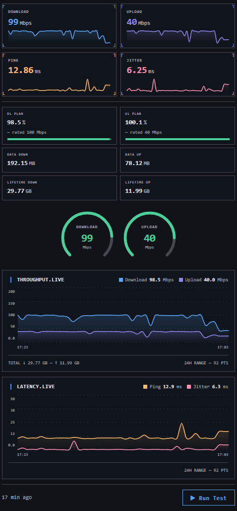

# PACE for Home Assistant

  

A Home Assistant custom integration for internet speed testing, built around **three interchangeable CLI backends**:

- **[LibreSpeed CLI](https://github.com/librespeed/speedtest-cli)** (LGPL-3.0) - self-hostable, supports custom servers
- **[Ookla Speedtest CLI](https://www.speedtest.net/apps/cli)** (official, proprietary binary) - widest server network, broadest architecture support
- **[speedtest-go](https://github.com/showwin/speedtest-go)** (MIT) - open-source client for the same server network as Ookla, no proprietary binary

Switch between backends at any time from the integration's options - **every sensor, binary sensor and button stays exactly the same regardless of which backend you pick.**

> PACE is a generalized successor to [librespeed-ha](https://github.com/gtxaspec/librespeed-ha), reusing its mature coordinator (circuit breaker, retry logic, repair flows, lifetime data tracking) and its Lovelace dashboard cards, extended to support multiple speed test engines behind one consistent entity set.

## Features

- Download/upload speed, ping, jitter sensors
- Lifetime data usage tracking (persisted across restarts)
- Optional ISP plan-compliance sensors (`% of your rated speed`)
- Automatic or manual scheduling
- Automatic vs. specific vs. custom server selection (backend-dependent)
- Independent internet connectivity monitoring (online/offline + public IP), with a rolling connectivity heartbeat trend shown on the dashboard/minimal cards
- Circuit breaker + repair flows for repeated failures or CLI download issues
- 3 bundled Lovelace cards: full dashboard (with optional radial gauges and history charts), minimal, and compact/bubble - each with a configurable title that links back to the integration's settings

## Screenshot

  

## Installation

### HACS (recommended)
Add this repository as a custom repository in HACS, then install "PACE".

> **Note**: starting with Home Assistant 2026.11, HACS ships built into Home Assistant itself as the **Marketplace** (under **Settings → Marketplace**, no separate download needed). If you're on 2026.11+, add this repository as a custom repository there instead — the process is otherwise the same. See the [HACS Marketplace docs](https://hacs.xyz/docs/marketplace/) for details.

### Manual
Copy `custom_components/pace/` into your Home Assistant `config/custom_components/` directory and restart.

## Setup

1. Go to **Settings → Devices & Services → Add Integration**, search for "PACE"
2. Pick a backend (LibreSpeed CLI / Ookla CLI / speedtest-go) and a server selection mode
3. The integration downloads the chosen CLI binary automatically on first setup

See [docs/CONFIGURATION.md](docs/CONFIGURATION.md) for all options, [docs/TROUBLESHOOTING.md](docs/TROUBLESHOOTING.md) for common issues, and [docs/ADVANCED_USAGE.md](docs/ADVANCED_USAGE.md) for automations and dashboards.

## Support

For issues and feature requests, please use the [GitHub issue tracker](https://github.com/twodrops/pace-ha/issues).

## License

This project is licensed under the MIT License - see the LICENSE file for details.

## Credits

- [LibreSpeed](https://github.com/librespeed/speedtest) - The open source speed test
- [LibreSpeed CLI](https://github.com/librespeed/speedtest-cli) - Official command line client
- [Ookla Speedtest CLI](https://www.speedtest.net/apps/cli) - Official Ookla command line client
- [speedtest-go](https://github.com/showwin/speedtest-go) - Open-source Go speed test client
- [librespeed-ha](https://github.com/gtxaspec/librespeed-ha) - The original single-backend integration PACE is built upon
